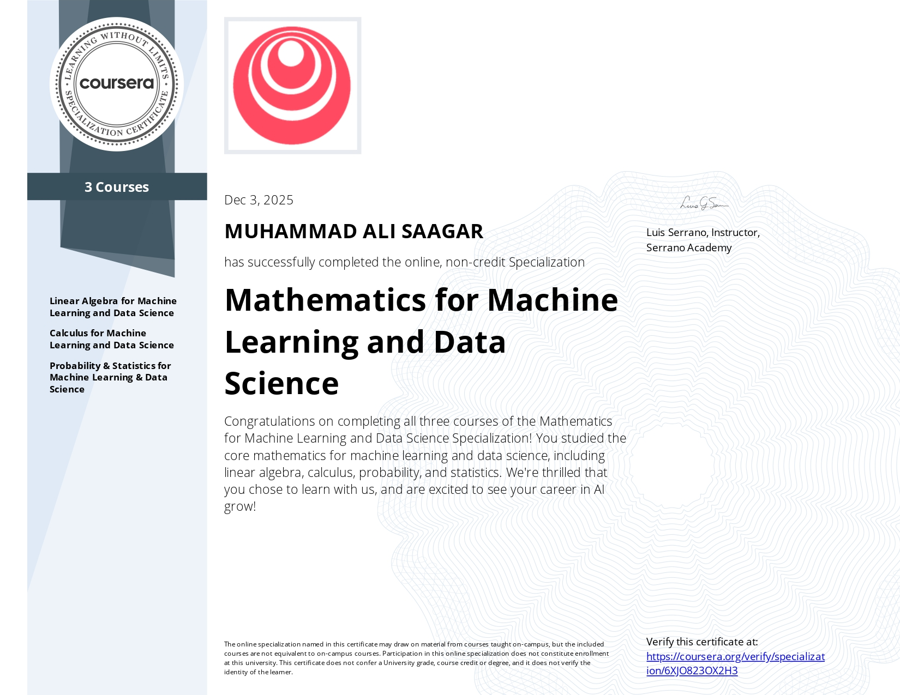

<div align="center">

# 🧮 Mathematics for AI and Machine Learning
  
### Building the mathematical foundation behind Machine Learning, Deep Learning, and Modern AI.
  
<br>


<br><br>

**University Foundation** • **Independent Study** • **Practical Implementation** • **ML-Focused Mathematics**

</div>

---

## 📐 About This Repository

Mathematics has always been one of the strongest parts of my academic journey.

Through university coursework, independent study, mathematical notes, and practical implementations, I have built and continued to strengthen the mathematical foundations that support **Machine Learning and AI**.

This repository brings together my mathematical learning, practice, implementations, and selected resources related to:

> **Linear Algebra • Calculus • Probability • Statistics • Mathematics for Machine Learning & Data Science**

---

## 🧠 Why Mathematics for AI?

Machine Learning is not only about algorithms and libraries.

Behind **feature vectors, model parameters, neural networks, optimization, embeddings, attention mechanisms, and Transformer architectures** are mathematical concepts involving:

**Vectors → Matrices → Transformations → Derivatives → Gradients → Probability → Optimization → High-Dimensional Spaces**

My goal with this repository is to connect the mathematical theory with practical implementation and understand not only *how* an ML method works, but also the **mathematical ideas underneath it**.

### The Bigger Picture

```text
Line
  ↓
Plane
  ↓
Hyperplane
  ↓
High-Dimensional Space
  ↓
Vectors
  ↓
Matrices
  ↓
Transformations
  ↓
Embeddings
  ↓
Attention
  ↓
Transformers
  ↓
Generative AI
```

---

# 🎓 Mathematical Foundation

My university studies provided a strong foundation through courses including:

| Course                              | Foundation                          |
| ----------------------------------- | ----------------------------------- |
| 📘 Precalculus I                    | Mathematical Foundations            |
| 📗 Precalculus II                   | Advanced Mathematical Foundations   |
| 📐 Calculus and Analytical Geometry | Calculus & Geometry                 |
| ∂ Multivariate Calculus             | Multivariable Analysis              |
| 🔢 Linear Algebra                   | Vectors, Matrices & Transformations |
| 🧩 Discrete Structures              | Logic, Sets, Graphs & Algorithms    |

### Academic Achievement

> 🏆 **A+ grades in these mathematics courses**

I have continued developing these foundations through **self-study and ML-focused learning**.

---

# 📚 Repository Contents

## 🔢 Linear Algebra

The `linear Algebra` section contains practical exploration of important linear algebra concepts using **Python and NumPy**.

### Current Work

* Matrix operations
* Vectors
* Linear transformations
* Singular Value Decomposition (SVD)
* Mathematical representations and transformations
* Practical NumPy implementations

The notebooks are designed to bridge the gap between **mathematical concepts and computational implementation**.

---

# 🤖 Mathematics for Machine Learning & Data Science

The `math_for_ML_DS_Coursera` section contains my study material and practice from the **Mathematics for Machine Learning and Data Science** specialization.

It includes material covering:

### 📐 Linear Algebra for Machine Learning and Data Science

Fundamental concepts involving vectors, matrices, transformations, and other linear algebra foundations used throughout ML.

### ∫ Calculus for Machine Learning and Data Science

Concepts that provide the mathematical foundation for understanding derivatives, gradients, optimization, and model training.

### 📊 Probability & Statistics for Machine Learning and Data Science

Foundations for understanding uncertainty, distributions, statistical reasoning, and probabilistic approaches in Machine Learning.

The section also contains selected practical coursework and assignment work.

---

# 🔗 From Mathematics to Machine Learning

One of the main purposes of this repository is to understand how mathematical concepts evolve into ideas used in AI.

| Mathematical Concept      | Machine Learning Connection                |
| ------------------------- | ------------------------------------------ |
| **Vectors**               | Features & learned representations         |
| **Matrices**              | Model parameters & transformations         |
| **Matrix Multiplication** | Representation transformations             |
| **Derivatives**           | Measuring how quantities change            |
| **Gradients**             | Direction used in optimization             |
| **Gradient Descent**      | Updating model parameters                  |
| **Geometry**              | Feature spaces & decision boundaries       |
| **SVD**                   | Dimensionality reduction & representations |

### Modern AI Connection

```text
Tokens
   ↓
Vectors
   ↓
Embeddings
   ↓
High-Dimensional Representations
   ↓
Attention
   ↓
Transformers
   ↓
Generative AI
```

> **The mathematics becomes more deeply embedded as the models become more sophisticated.**

---

# 💻 Practical Work

I believe mathematical understanding becomes stronger when theory is connected with implementation.

This repository therefore includes practical **Python / NumPy notebooks** where mathematical concepts are explored computationally.

### Current Focus

* 🔢 Matrices
* ➡️ Vectors
* 🔄 Transformations
* 📉 SVD
* ⚙️ Linear algebra operations
* 🧮 Mathematical representations
* 🤖 ML-focused mathematical concepts

More mathematical notebooks and implementations will be added as I continue expanding this repository.

---

# ✍️ Handwritten Mathematics Notes

I have also maintained handwritten notes throughout my mathematical studies.

These notes contain **derivations, formulas, worked examples, concepts, and personal explanations** developed while studying mathematics at university and through independent learning.

Selected handwritten notes will be added to this repository as an additional record of the learning process.

<div align="center">

### Theory → Notes → Implementation → Application

</div>

---

# 🎓 Mathematics for Machine Learning & Data Science

I completed the **Mathematics for Machine Learning and Data Science** specialization from **DeepLearning.AI / Coursera** as part of my continued effort to strengthen the mathematical foundations required for Machine Learning and Data Science.

### Certificate

 

<p align="center">
  <a href="math_for_ML_DS_Coursera/MLDS_specialization_coursera_page-0001.jpg">
    
  </a>
</p>
---

# 🧭 Learning Philosophy

I believe that learning Machine Learning should not begin and end with calling a library function.

It is easy to move directly from:

```text
Python
   ↓
NumPy
   ↓
Pandas
   ↓
Scikit-learn
   ↓
ML Models
```

But deeper understanding comes from asking:

* What is a feature vector?
* Why are model parameters represented as matrices?
* What does a transformation mean?
* Why do gradients matter?
* How does gradient descent update parameters?
* Why do dimensions and tensor shapes matter?
* How are mathematical representations transformed inside neural networks?
* What mathematical ideas appear inside Transformer architectures?

This repository is part of my effort to answer those questions **from the mathematical foundation upward**.

---

# 🛠️ Tools & Technologies

<div align="center">


</div>

---

# 🗺️ Repository Roadmap

This repository will continue evolving as I deepen my understanding of mathematical foundations for AI.

### Planned Areas

* [ ] More Linear Algebra practice
* [ ] Calculus implementations
* [ ] Optimization
* [ ] Probability
* [ ] Statistics
* [ ] Additional NumPy implementations
* [ ] More handwritten mathematical notes
* [ ] Mathematical concepts connected to Deep Learning
* [ ] Mathematical foundations behind Transformers and Generative AI

---

# 👨‍💻 Author

<div align="center">

## Muhammad Ali Saagar

**Computer Science Student | Python | Data Science | Machine Learning | AI**

<br>

<a href="https://github.com/AliMuhammad78">

</a>

<a href="https://www.linkedin.com/in/muhammad-ali-91294a290">

</a>

<a href="https://www.youtube.com/@TechyBits20121">

</a>

</div>

---

<div align="center">

### 🧮 From Mathematical Foundations to Intelligent Systems

**Understanding the mathematics behind the models.**

<br>

`Linear Algebra` • `Calculus` • `Probability` • `Statistics` • `Optimization` • `Machine Learning` • `Deep Learning` • `Generative AI`

</div>
